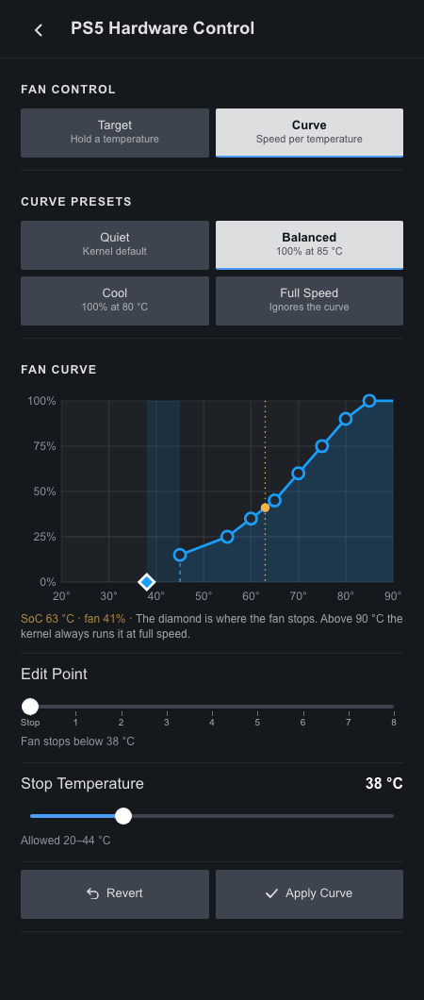
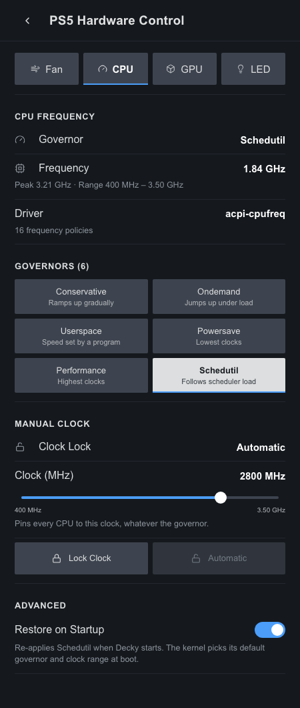
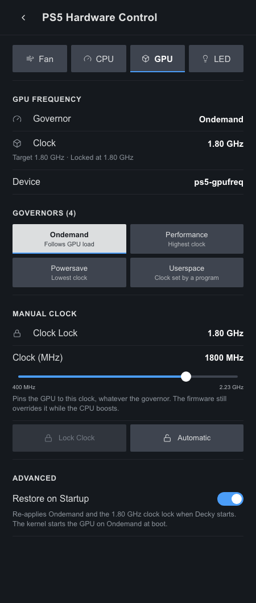
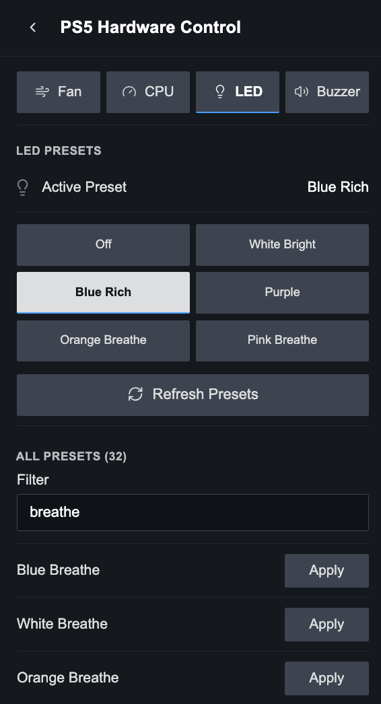

<h1 align="center">ps5-hwcon-plugin</h1>

<p align="center">
  
  &nbsp;
  
  &nbsp;
  
  &nbsp;
  
</p>

<p align="center">
  A <a href="https://decky.xyz">Decky Loader</a> plugin for PS5 Linux: fan curve or target temperature, live temperatures, CPU and GPU governors and clocks, and indicator LED presets, all from the Quick Access Menu.
</p>

---

## Install

Run this on the PS5 as your normal user (not root):

```sh
curl -fsSL https://raw.githubusercontent.com/NotHavocc/ps5-hwcon-plugin/main/install.sh | bash
```

The installer:
- checks for Decky and the PS5 kernel interfaces
- clones this repo and builds the plugin. If Node.js isn't installed, as on stock Bazzite, it builds inside a podman or docker container.
- installs the plugin to `~/homebrew/plugins/ps5-hardware-control`
- restarts Decky and waits for the plugin to load

Run the same command again to update. Your settings are kept.

To uninstall:

```sh
curl -fsSL https://raw.githubusercontent.com/NotHavocc/ps5-hwcon-plugin/main/install.sh | bash -s -- --uninstall
```

### Install from a .zip

This skips the build, so you don't need `git`, Node.js or podman.

1. Download `ps5-hwcon-plugin.zip` from the [Releases](https://github.com/NotHavocc/ps5-hwcon-plugin/releases) page, or build it yourself with `npm run zip` (it lands in `out/`).
2. In the Decky menu, open Settings (the gear icon).
3. Under **General**, turn on **Developer mode**.
4. Open the **Developer** section and choose **Install Plugin from ZIP File**, then pick the zip.

To update, install the newer zip the same way. Your settings are kept.

### Install from a URL

Decky can download the release zip itself, so you don't have to copy a file onto the PS5.

1. In the Decky menu, open Settings (the gear icon).
2. Under **General**, turn on **Developer mode**.
3. Open the **Developer** section and choose **Install Plugin from URL**.
4. Enter this URL and choose **Install**:

   ```
   https://github.com/NotHavocc/ps5-hwcon-plugin/releases/latest/download/ps5-hwcon-plugin.zip
   ```

This link always points to the newest release, so entering it again updates the plugin. Your settings are kept. To install a specific version, replace `latest/download` with `download/v1.3.0` (or another release tag).

### Requirements

- A PS5 running Linux with the [ps5-linux-patches](https://github.com/rmuxnet/ps5-linux-patches-1) kernel booted. The plugin only talks to the sysfs interfaces that kernel adds.
- [Decky Loader](https://decky.xyz) 3.0 or newer. On Bazzite: `ujust setup-decky`.
- `git`, plus either Node.js 18+ or podman/docker for the build.

## Features

### Fan

**Fan Control** switches between **Target** (the original control) and **Curve**. Fan curves need a kernel with the `ps5_fan` hwmon driver (rmuxnet/ps5-linux-patches-1 `meower` from [`883eef9`](https://github.com/rmuxnet/ps5-linux-patches-1/commit/883eef9)); without it the tab opens on Target and Curve is greyed out. Those kernels drop `target_temp`, so there a target is applied as a curve that reaches 45% at the target and full speed 6 °C above it.

- **Temperatures**: live CPU (`k10temp`) readings, plus any other hwmon sensors, refreshed every 2 s. On curve kernels the fan's current speed and mode are shown too.
- **Fan curve** (hwmon kernels): the graph shows the 8 curve points (SoC temperature → fan speed), the stop temperature (diamond) and the live SoC temperature and fan speed. Pick a point with **Edit Point**, set its **Temperature** and **Fan Speed** with the sliders, then **Apply Curve**. The sliders keep the curve valid for the driver: temperatures rise from point to point, speed never drops, and the last point is 100%. Above 90 °C the kernel runs the fan at full speed no matter what.
- **Curve presets**: Quiet (the kernel default), Balanced, Cool, and Full Speed.
- **Target presets**: Quiet 85 °C, Default 80 °C, Balanced 72 °C, Cool 65 °C and Max Cooling 50 °C. A lower target spins the fan up earlier and louder.
- **Manual Target**: any target from 40 to 90 °C.
- **Restore on Startup**: re-applies your last curve or target when Decky starts. The kernel resets both on every boot.
- **Thermal Guard**: when the CPU reaches the Overheat Threshold (80–100 °C, default 95), the fan switches to Full Speed (or the Max Cooling target). Your setting comes back once the CPU is 10 °C cooler.
- **Overheat Alarm**: plays the console's error beep once when the CPU reaches the threshold, and re-arms after it cools down.

Thermal Guard and Overheat Alarm run in the background, even with the menu closed.

Restore on Startup applies each setting as soon as its driver is ready. If a driver is still loading when Decky starts, the plugin keeps retrying for up to 60 s and logs which settings it is waiting for, or gave up on.

### CPU

- **Governor**: lists every cpufreq governor the kernel offers (`scaling_available_governors`) and applies your choice to all CPUs. Only governors built into or loaded by the kernel are shown.
- **Status**: active governor, average and peak clock, hardware range and the cpufreq driver, refreshed every 2 s. If CPUs disagree, it shows **Mixed**.
- **Manual Clock**: locks every CPU to one clock by setting `scaling_min_freq` and `scaling_max_freq` to the same value. The slider covers the hardware range and snaps to `scaling_available_frequencies` when the driver lists them. The lock applies under any governor. **Automatic** restores the full range.
- **Restore on Startup**: re-applies your last governor and clock lock when Decky starts.

With an EPP driver such as `amd-pstate-epp`, the kernel only offers Performance and Powersave. The firmware still manages clocks under Powersave.

### GPU

- **Governor**: lists the devfreq governors the `ps5-gpufreq` driver offers (`/sys/class/devfreq/ps5-gpufreq/available_governors`): Ondemand (`simple_ondemand`, the kernel default), Performance, Powersave and Userspace.
- **Status**: active governor, current GPU clock, target clock and the allowed range, refreshed every 2 s.
- **Manual Clock**: locks the GPU to one of the frequencies in `available_frequencies` by setting the devfreq `min_freq` and `max_freq` to the same value. The lock applies under any governor. **Automatic** removes both limits.
- **Restore on Startup**: re-applies your last GPU governor and clock lock when Decky starts.

GPU governors need a kernel built with `CONFIG_PS5_GPUFREQ` (ps5-linux-patches, October 2026 or newer). While the CPU runs at a boost clock (3.3–3.5 GHz), the firmware takes over the GPU clock and holds it at the 2.23 GHz ceiling, regardless of the GPU governor or clock lock.

### LED

- Quick buttons for Off, White Bright, Blue Rich, Purple, Orange Breathe and Pink Breathe.
- A searchable list of every preset the kernel exposes.
- **Loop Animations**: the firmware plays breathe and pulse animations once. This option replays them on an interval you choose (2–30 s), and keeps going in the background.
- **Restore on Startup**: re-applies your last LED preset when Decky starts.

## Translations

The plugin follows the language exposed by Decky's browser UI. English is the
built-in fallback and Swedish is included. UI text is routed through the small
catalog in `src/i18n.ts`; to add another language, add its ISO language code
and translations to `catalogs`. No component changes or external translation
service are required.

## Credits

- [rmuxnet/ps5-linux-patches](https://github.com/rmuxnet/ps5-linux-patches-1) for the kernel drivers this plugin builds on.
- [Decky Loader](https://github.com/SteamDeckHomebrew/decky-loader).
