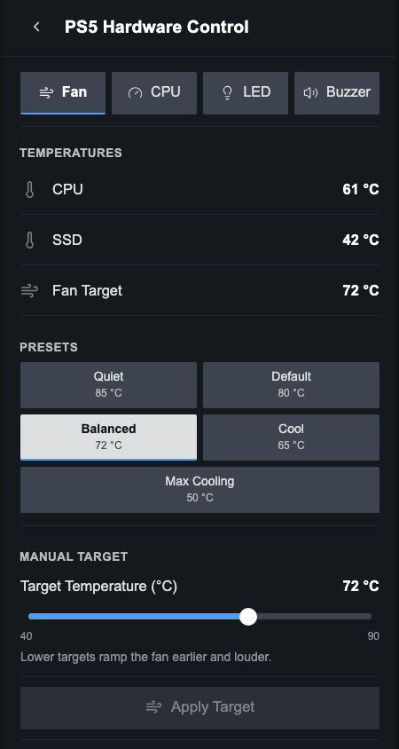
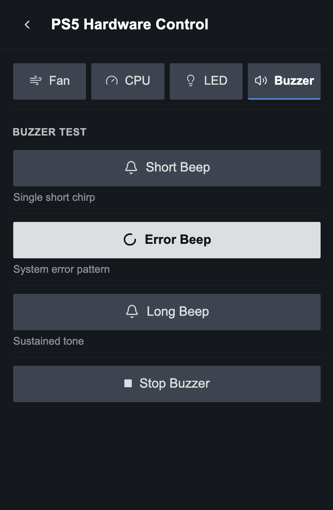

<h1 align="center">ps5-hwcon-plugin</h1>

<p align="center">
  
  &nbsp;
  
  &nbsp;
  
  &nbsp;
  
</p>

<p align="center">
  A <a href="https://decky.xyz">Decky Loader</a> plugin for PS5 Linux: fan target temperature, live temperatures, CPU governor, indicator LED presets and the chassis buzzer, all from the Quick Access Menu.
</p>

---

## Install

Run this on the PS5 as your normal user (not root):

```sh
curl -fsSL https://raw.githubusercontent.com/NotHavocc/ps5-hwcon-plugin/main/install.sh | bash
```

The installer:
- checks for Decky and the PS5 kernel interfaces
- clones this repo and builds the plugin. If Node.js isn't installed, as on stock Bazzite, it builds inside a podman or docker container.
- installs the plugin to `~/homebrew/plugins/ps5-hardware-control`
- restarts Decky and waits for the plugin to load

Run the same command again to update. Your settings are kept.

To uninstall:

```sh
curl -fsSL https://raw.githubusercontent.com/NotHavocc/ps5-hwcon-plugin/main/install.sh | bash -s -- --uninstall
```

### Install from a .zip

This skips the build, so you don't need `git`, Node.js or podman.

1. Download `ps5-hwcon-plugin.zip` from the [Releases](https://github.com/NotHavocc/ps5-hwcon-plugin/releases) page, or build it yourself with `npm run zip` (it lands in `out/`).
2. In the Decky menu, open Settings (the gear icon).
3. Under **General**, turn on **Developer mode**.
4. Open the **Developer** section and choose **Install Plugin from ZIP File**, then pick the zip.

To update, install the newer zip the same way. Your settings are kept.

### Requirements

- A PS5 running Linux with the [ps5-linux-patches](https://github.com/rmuxnet/ps5-linux-patches-1) kernel booted. The plugin only talks to the sysfs interfaces that kernel adds.
- [Decky Loader](https://decky.xyz) 3.0 or newer. On Bazzite: `ujust setup-decky`.
- `git`, plus either Node.js 18+ or podman/docker for the build.

## Features

### Fan

- **Temperatures**: live CPU (`k10temp`) readings, plus any other hwmon sensors, refreshed every 2 s.
- **Presets**: Quiet 85 °C, Default 80 °C, Balanced 72 °C, Cool 65 °C and Max Cooling 50 °C. A lower target spins the fan up earlier and louder.
- **Manual Target**: any target from 40 to 90 °C.
- **Restore on Startup**: re-applies your last target when Decky starts. The kernel resets it to 80 °C on every boot.
- **Thermal Guard**: when the CPU reaches the Overheat Threshold (80–100 °C, default 95), the fan switches to Max Cooling. Your target comes back once the CPU is 10 °C cooler.
- **Overheat Alarm**: plays the console's error beep once when the CPU reaches the threshold, and re-arms after it cools down.

Thermal Guard and Overheat Alarm run in the background, even with the menu closed.

### CPU

- **Governor**: lists every cpufreq governor the kernel offers (`scaling_available_governors`) and applies your choice to all CPUs. Only governors built into or loaded by the kernel are shown.
- **Status**: active governor, average and peak clock, hardware range and the cpufreq driver, refreshed every 2 s. If CPUs disagree, it shows **Mixed**.
- **Restore on Startup**: re-applies your last governor when Decky starts.

With an EPP driver such as `amd-pstate-epp`, the kernel only offers Performance and Powersave. The firmware still manages clocks under Powersave.

### LED

- Quick buttons for Off, White Bright, Blue Rich, Purple, Orange Breathe and Pink Breathe.
- A searchable list of every preset the kernel exposes.
- **Loop Animations**: the firmware plays breathe and pulse animations once. This option replays them on an interval you choose (2–30 s), and keeps going in the background.

### Buzzer

- Short, Error and Long test beeps, plus Stop.

## Credits

- [rmuxnet/ps5-linux-patches](https://github.com/rmuxnet/ps5-linux-patches-1) for the kernel drivers this plugin builds on.
- [Decky Loader](https://github.com/SteamDeckHomebrew/decky-loader).
