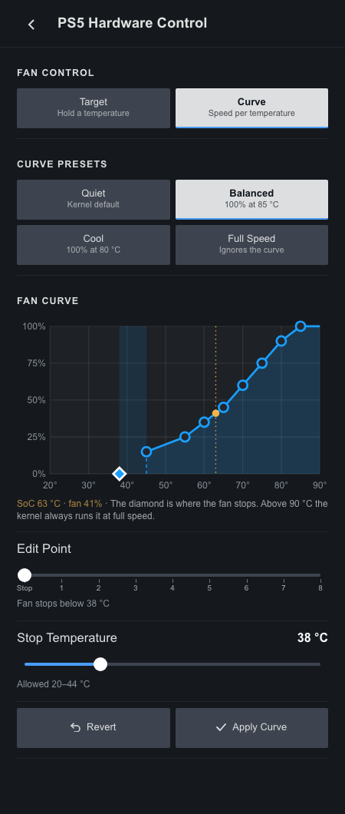
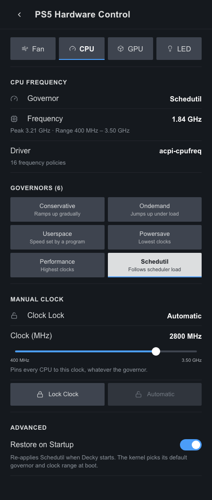
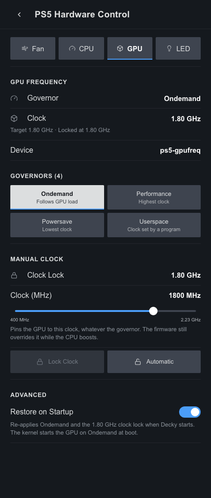
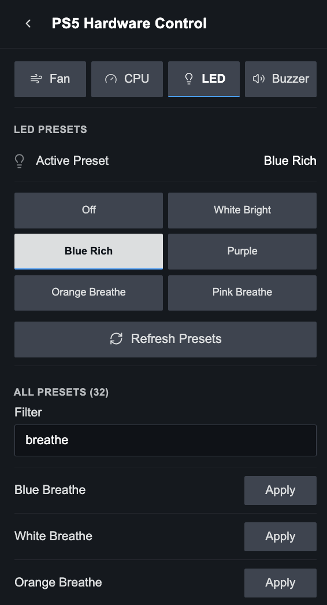

<h1 align="center">ps5-hwcon-plugin</h1>

<p align="center">
  
  &nbsp;
  
  &nbsp;
  
  &nbsp;
  
</p>

<p align="center">
  A <a href="https://decky.xyz">Decky Loader</a> plugin for PS5 Linux: fan curve or target temperature, live temperatures, CPU and GPU governors and clocks, GPU memory, zram and zswap, and indicator LED presets, all from the Quick Access Menu.
</p>

---

## Install

Run this on the PS5 as your normal user (not root):

```sh
curl -fsSL https://raw.githubusercontent.com/NotHavocc/ps5-hwcon-plugin/main/install.sh | bash
```

The installer:
- checks for Decky and the PS5 kernel interfaces
- clones this repo and builds the plugin. If Node.js isn't installed, as on stock Bazzite, it builds inside a podman or docker container.
- installs the plugin to `~/homebrew/plugins/ps5-hardware-control`
- restarts Decky and waits for the plugin to load

Run the same command again to update. Your settings are kept.

To uninstall:

```sh
curl -fsSL https://raw.githubusercontent.com/NotHavocc/ps5-hwcon-plugin/main/install.sh | bash -s -- --uninstall
```

### Install from a .zip

This skips the build, so you don't need `git`, Node.js or podman.

1. Download `ps5-hwcon-plugin.zip` from the [Releases](https://github.com/NotHavocc/ps5-hwcon-plugin/releases) page, or build it yourself with `npm run zip` (it lands in `out/`).
2. In the Decky menu, open Settings (the gear icon).
3. Under **General**, turn on **Developer mode**.
4. Open the **Developer** section and choose **Install Plugin from ZIP File**, then pick the zip.

To update, install the newer zip the same way. Your settings are kept.

### Install from a URL

Decky can download the release zip itself, so you don't have to copy a file onto the PS5.

1. In the Decky menu, open Settings (the gear icon).
2. Under **General**, turn on **Developer mode**.
3. Open the **Developer** section and choose **Install Plugin from URL**.
4. Enter this URL and choose **Install**:

   ```
   https://github.com/NotHavocc/ps5-hwcon-plugin/releases/latest/download/ps5-hwcon-plugin.zip
   ```

This link always points to the newest release, so entering it again updates the plugin. Your settings are kept. To install a specific version, replace `latest/download` with `download/v1.3.0` (or another release tag).

### Requirements

- A PS5 running Linux with the [ps5-linux-patches](https://github.com/ps5-linux/ps5-linux-patches) kernel booted. The plugin only talks to the sysfs interfaces that kernel adds.
- [Decky Loader](https://decky.xyz) 3.0 or newer. On Bazzite: `ujust setup-decky`.
- `git`, plus either Node.js 18+ or podman/docker for the build.

## Features

### Fan

**Fan Control** switches between **Target** (the original control) and **Curve**. Fan curves need a kernel with the `ps5_fan` hwmon driver, which ps5-linux-patches includes from 7.2.3 ([#60](https://github.com/ps5-linux/ps5-linux-patches/pull/60)). The plugin and installer look for that device rather than the kernel version, so any kernel carrying the driver works. Without it the tab opens on Target and Curve is greyed out. Kernels with the driver drop `target_temp`, so there a target is applied as a curve that reaches 45% at the target and full speed 6 °C above it.

- **Temperatures**: live CPU (`k10temp`) readings, plus any other hwmon sensors, refreshed every 2 s. On curve kernels the fan's current speed and mode are shown too.
- **Fan curve** (hwmon kernels): the graph shows the 8 curve points (SoC temperature → fan speed), the stop temperature (diamond) and the live SoC temperature and fan speed. Pick a point with **Edit Point**, set its **Temperature** and **Fan Speed** with the sliders, then **Apply Curve**. The sliders keep the curve valid for the driver: temperatures rise from point to point, speed never drops, and the last point is 100%. Above 90 °C the kernel runs the fan at full speed no matter what.
- **Curve presets**: Quiet (the kernel default), Balanced, Cool, and Full Speed.
- **Target presets**: Quiet 85 °C, Default 80 °C, Balanced 72 °C, Cool 65 °C and Max Cooling 50 °C. A lower target spins the fan up earlier and louder.
- **Manual Target**: any target from 40 to 90 °C.
- **Restore on Startup**: re-applies your last curve or target when Decky starts. The kernel resets both on every boot.
- **Thermal Guard**: when the CPU reaches the Overheat Threshold (80–100 °C, default 95), the fan switches to Full Speed (or the Max Cooling target). Your setting comes back once the CPU is 10 °C cooler.
- **Overheat Alarm**: plays the console's error beep once when the CPU reaches the threshold, and re-arms after it cools down.

Thermal Guard and Overheat Alarm run in the background, even with the menu closed.

Restore on Startup applies each setting as soon as its driver is ready. If a driver is still loading when Decky starts, the plugin keeps retrying for up to 60 s and logs which settings it is waiting for, or gave up on.

### CPU

- **Governor**: lists every cpufreq governor the kernel offers (`scaling_available_governors`) and applies your choice to all CPUs. Only governors built into or loaded by the kernel are shown.
- **Status**: active governor, average and peak clock, hardware range and the cpufreq driver, refreshed every 2 s. If CPUs disagree, it shows **Mixed**.
- **Manual Clock**: locks every CPU to one clock by setting `scaling_min_freq` and `scaling_max_freq` to the same value. The slider covers the hardware range and snaps to `scaling_available_frequencies` when the driver lists them. The lock applies under any governor. **Automatic** restores the full range.
- **Restore on Startup**: re-applies your last governor and clock lock when Decky starts.

With an EPP driver such as `amd-pstate-epp`, the kernel only offers Performance and Powersave. The firmware still manages clocks under Powersave.

### GPU

- **Governor**: lists the devfreq governors the `ps5-gpufreq` driver offers (`/sys/class/devfreq/ps5-gpufreq/available_governors`): Ondemand (`simple_ondemand`, the kernel default), Performance, Powersave and Userspace.
- **Status**: active governor, current GPU clock, target clock and the allowed range, refreshed every 2 s.
- **Manual Clock**: locks the GPU to one of the frequencies in `available_frequencies` by setting the devfreq `min_freq` and `max_freq` to the same value. The lock applies under any governor. **Automatic** removes both limits.
- **Restore on Startup**: re-applies your last GPU governor and clock lock when Decky starts.

- **CU Unlock**: turns on the compute units disabled at the factory (36 or 38 active out of 40). **40 CUs** adds `amdgpu.ps5_cu_unlock=3` to `cmdline.txt` on the boot drive, and **38 CUs** also adds `amdgpu.disable_cu=0.0.0` to mask one pair, so both need a reboot. **Off** removes both arguments, including a `disable_cu` you added yourself. The previous file is kept as `cmdline.txt.bak`. **Active CUs** shows the count the driver reported. Only an even split across both shader engines helps performance, so 38 CUs usually scores the same as 36. Some disabled CUs can be faulty, and the pair masked for 38 CUs is always the same one, so it may not avoid them. If you see glitches, try `RADV_DEBUG=nohiz`, then turn this off. If the screen is unusable, remove the arguments over SSH or from another computer.
- **Apply Now** (experimental): after changing CU Unlock, applies it without a reboot by stopping the display manager, reloading `amdgpu` with the new arguments and starting the display manager again. Steam and any running game close, while Decky keeps running in the background. If the new arguments fail to load, it falls back to the previous ones. It needs `amdgpu` built as a module, systemd and a display manager, and the tab says which one is missing. It runs as the transient unit `ps5-hwcon-cu-reload`, so check `journalctl -u ps5-hwcon-cu-reload` for what happened.
- **Boot partition**: CU Unlock, GPU Memory and zswap edit files on the FAT partition the console booted from, wherever the distro or desktop mounted it. If it isn't mounted, the plugin mounts it read-only at `/boot/efi` (or `/run/ps5-hwcon/boot` if that's taken), and only makes it writable while saving. It picks the partition whose `cmdline.txt` has the running `root=` argument. If it can't find one, or can't tell which one that is, the GPU or Memory tab shows why.

GPU governors need a kernel built with `CONFIG_PS5_GPUFREQ`. The driver isn't part of [ps5-linux-patches](https://github.com/ps5-linux/ps5-linux-patches) itself, so on those kernels the GPU tab shows why it's unavailable and everything else works normally. While the CPU runs at a boost clock (3.3–3.5 GHz), the firmware takes over the GPU clock and holds it at the 2.23 GHz ceiling, regardless of the GPU governor or clock lock.

### Memory

- **Overview**: live RAM and swap usage, including each swap device, refreshed every 2 s.
- **GPU Memory**: **VRAM** writes `vram.txt` on the boot drive, in the hex format the loader expects, and warns if the existing value looks wrong. It's a minimum that stays reserved from system RAM. 6 GB is the recommended choice for gaming. Pick 512 MB if you don't game, or set any size from 256 MB to 12 GB with **Custom Size**. **GTT Limit** sets `ttm.pages_limit` in `cmdline.txt`, which raises how much system RAM the GPU can use without reserving it, so try this if a game runs out of memory. Both need a reboot. See the [wiki](https://wiki.ps5-linux.eu/post-install/all-distros/#memory-and-swap) for how the two interact.
- **zram**: turns compressed swap in RAM on or off and sets its size and compression, by writing `/etc/systemd/zram-generator.conf` (the previous file is kept as `.bak`). Needs `zram-generator` and a reboot. Turning it off writes a config without a device, which also masks a distro default.
- **zswap**: switches zswap on or off immediately and saves `zswap.enabled` in `cmdline.txt`. It only helps with swap on a drive, so leave it off when using zram.

### LED

- Quick buttons for Off, White Bright, Blue Rich, Purple, Orange Breathe and Pink Breathe.
- A searchable list of every preset the kernel exposes.
- The active preset survives a Decky restart. After a reboot it shows as unknown until you pick a preset (or Restore on Startup does), because the kernel picks its own default LED.
- **Loop Animations**: the firmware plays breathe and pulse animations once. This option replays them on an interval you choose (2–30 s), and keeps going in the background.
- **Restore on Startup**: re-applies your last LED preset when Decky starts.

## Credits

- [rmuxnet/ps5-linux-patches](https://github.com/rmuxnet/ps5-linux-patches-1) for the kernel drivers this plugin builds on.
- [Decky Loader](https://github.com/SteamDeckHomebrew/decky-loader).
